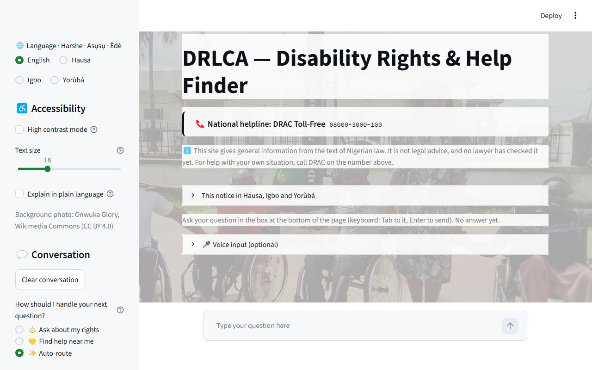
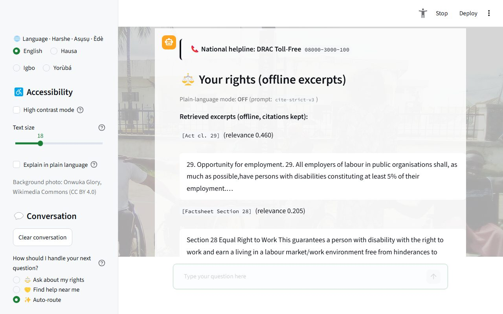
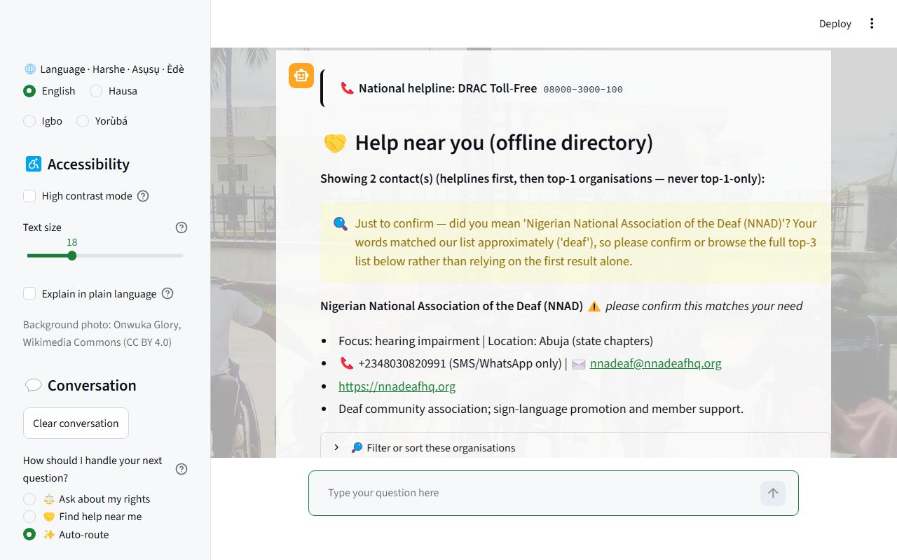
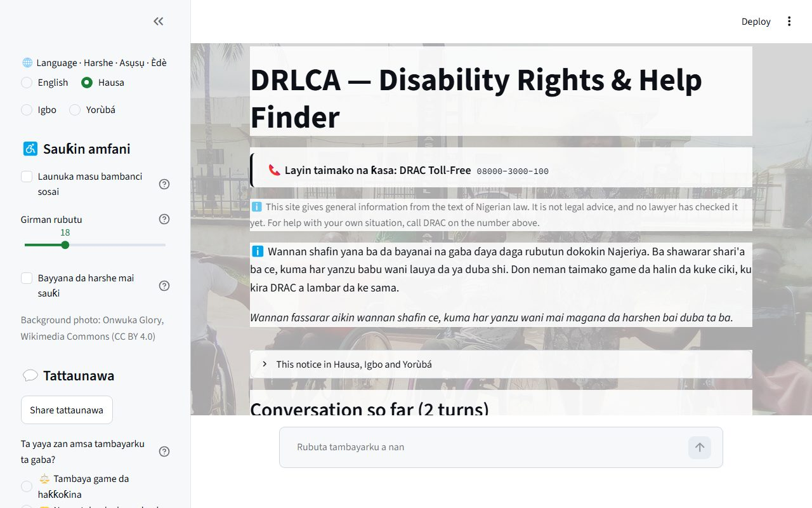
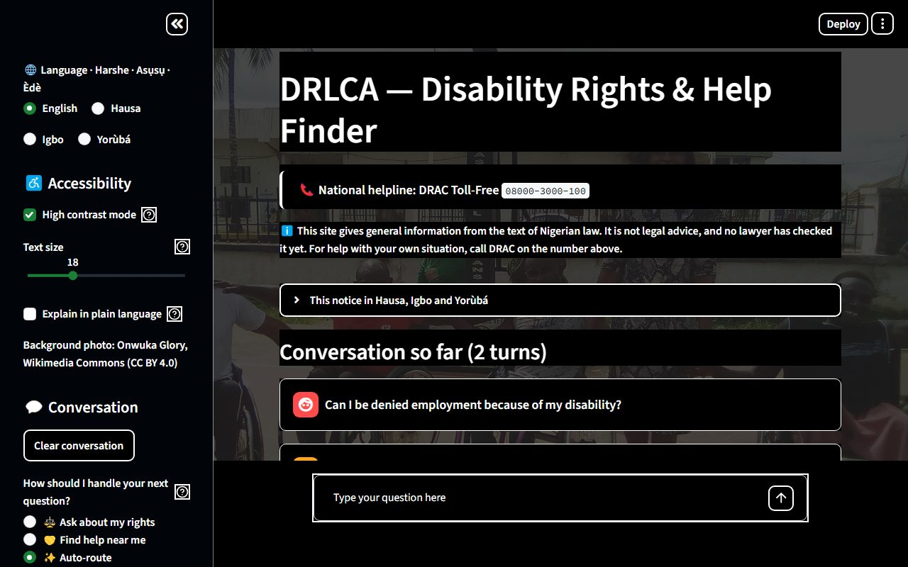
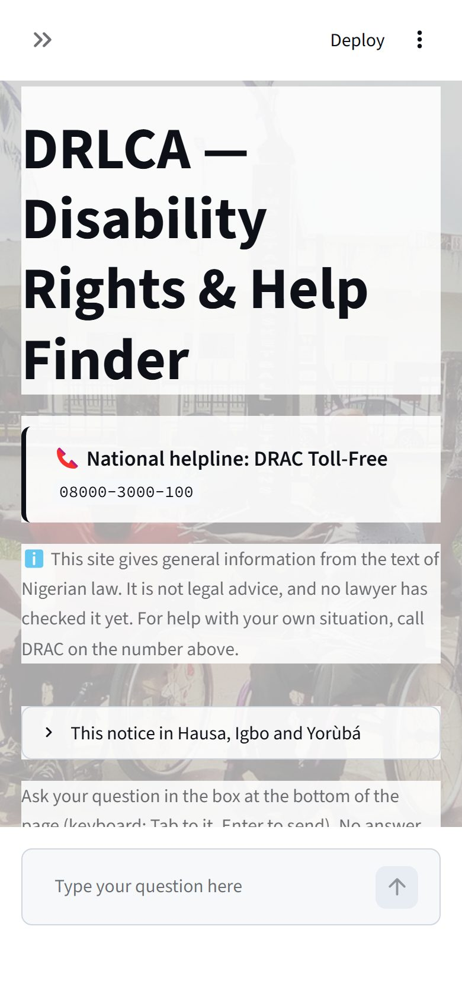

# DRLCA — Disability Rights & Help Finder (Nigeria)

A free, accessible chatbot that helps persons with disabilities in Nigeria find **what the law says** and **who can help**.
It answers from the text of the **Discrimination Against Persons with Disabilities (Prohibition) Act 2018**, the
**1999 Constitution** and a **2020 factsheet** on the Act, and it points people to verified disability organisations.

**Live:** **https://ngodisabilityrag.onrender.com** (free hosting; the first load after a quiet spell takes about a minute)

**National helpline, shown first on every page and every answer:** DRAC Toll-Free **08000-3000-100**
(verified on [drac-ng.org](https://drac-ng.org) on 2026-10-25).

> **Not legal advice.** DRLCA gives general information from the text of Nigerian law. No lawyer has reviewed it yet,
> and the site says so on every page. For help with your own situation, call DRAC.

---

## Demo


59 seconds, recorded on a local copy: **"Explain in plain language"** is ticked, the employment question is answered
from the law's own words, and then the optional **AI answer** explains it simply, with a citation after every sentence.
That AI answer is one real Gemini call (free tier). Everything else in the video runs offline.
[Full-quality MP4](docs/media/demo.mp4).

## Screenshots

| | |
|---|---|
|  |  |
| **Helpline first**, then the honest notice | **Legal answers** quote the law word for word, with a citation tag on every excerpt |
|  |  |
| **Help near you**: helpline first, then verified organisations, with filters | **Hausa, Igbo, Yorùbá** interface (the law itself stays in its official English text) |
|  |  |
| **High contrast** and adjustable text size | **Phone-first** layout |

**Optional AI answer in plain language.** It is off by default and only runs when the user asks. The prompt only lets it
use the excerpts shown above it, and every sentence must carry their citation tags, which are checked against the
retrieved excerpts:

![The AI answer in plain language: "No. A person with a disability has an equal right to work and earn a living [Factsheet Section 28]…", with the citations listed underneath and the not-legal-advice notice above it](docs/media/07_ai_plain_answer.jpg)

## What it does

* **Ask in plain words, as a conversation.** Follow-up questions build on earlier turns, so you don't have to repeat
  yourself.
* **Legal answers are the law's own words.** Retrieved excerpts carry citation tags (`[Act cl. N]`,
  `[Constitution s. N]`, `[Factsheet Section N]`) that are never stripped or renumbered. If the documents don't cover a
  question, it says so and points to the helpline, rather than guessing.
* **Help near you.** A directory of 20 disability organisations across Nigeria's six zones. Every phone number was checked
  in a real browser on the organisation's own site, and placeholders fail loudly at load. Results can be filtered by
  disability and state.
* **Works offline by default.** Search, excerpts, the directory and routing make no network calls. An optional AI summary
  (Google Gemini, free tier) is off unless the user opens it, and it must cite the same excerpts.
* **Accessible by design, not as polish.** It has a screen-reader-safe linear layout, keyboard navigation with a skip
  link, high contrast, text scaling, read-aloud on every answer and optional voice input. Automated WCAG 2.2 AA checks
  find 0 issues across 33 screen-size × theme combinations.
* **Interface in English, Hausa, Igbo and Yorùbá.** The menus, labels and instructions are translated. Legal text,
  citation tags and phone numbers never are.
* **Private.** The conversation lives only in the browser session and is never written to disk. The optional "Was this
  helpful?" signal records counts only (no question text unless the user opts in, no IP and no session id).

## Honest limits

* **No lawyer has reviewed the answers.** Every "correct" in our records is a match against the official text or an
  automated check. External legal and language review will come once the project is funded. Until then, self-review
  checks stand in, and they are labelled as such
  ([docs/phases/19_zero_cost_self_review.md](docs/phases/19_zero_cost_self_review.md)).
* **The translations are our own** and have not been checked by native speakers.
* **Search is keyword-based (TF-IDF), and wording matters.** For example, "Can I be denied employment because of my
  disability?" finds the employment clause (Act cl. 29), but "Can my employer refuse to hire me because I'm blind?"
  currently does not. Measured retrieval numbers, including the misses, are in [STATUS.md](STATUS.md).
* **The free host sleeps when idle**, so the first visit can be slow.

## How it works

```
Streamlit chat UI (app.py)          helpline banner → notice → conversation → chat box
  ├─ src/chat.py     follow-ups: resolves "they", "so can they…" against earlier turns
  ├─ src/router.py   legal / help / greeting / clarify (keyword scorer, stateless)
  ├─ legal → src/retrieve.py + src/rag.py
  │          per-document TF-IDF, 4 excerpts per document, refusal floor (MIN_SCORE 0.10),
  │          optional cite-checked Gemini summary (off by default)
  └─ help  → src/ngo.py  data/ngo.csv, helpline first, top-k, never top-1-only
src/ui_render.py (shared render helpers) · src/ui_i18n.py (interface language) · src/telemetry.py (counts only)
```

No LangChain: the orchestration is about 5,800 lines of plain Python, so every step can be measured and tested.

## Run it locally

```bash
conda create -p C:\conda-envs\drlca-rag python=3.11 pip -y
C:\conda-envs\drlca-rag\python.exe -m pip install -r requirements-rag.txt
C:\conda-envs\drlca-rag\python.exe -m streamlit run app.py      # → http://localhost:8501
```

`GOOGLE_API_KEY` is optional and only needed for the AI summary. `requirements.txt` is the slim runtime used on Render.

**Tests** (plain assert scripts, zero network, run in CI on every push):

```bash
python scripts/test_phase03.py   # NGO directory: helpline first, verified phones, fuzzy matching
python scripts/test_phase04.py   # router
python scripts/test_phase05.py   # UI contract, accessibility, translations
python scripts/test_phase09_ops.py
python scripts/audit_corpus.py
```

The README media is reproducible. Run `tools/a11y_audit/capture_readme_media.mjs` against a **local** server (never
the live site, because the demo asks questions; add `--with-ai` for the AI segment, one free Gemini call, cached after), then encode with ffmpeg:
`ffmpeg -i demo.webm -c:v libx264 -crf 26 -pix_fmt yuv420p demo.mp4`.

## Project records

* [STATUS.md](STATUS.md): current state and numbers
* [HANDOFF.md](HANDOFF.md): where work stands, next steps
* [docs/phases/](docs/phases/): one playbook per phase, with results, including what was tried and declined
* [LEARNING_JOURNAL.md](LEARNING_JOURNAL.md): what each step taught
* [docs/accessibility.md](docs/accessibility.md): the accessibility record
* `RAGNGO.txt`: the original specification

Built on free tiers only ($0.00). Background photo: Onwuka Glory, Wikimedia Commons (CC BY 4.0).
